<p align="center">
  
</p>

---

## 👨‍💻 About Me

```yaml
name: Piyush Thawkar
located_in: India
current_focus: DevOps, Cloud Computing, Automation
tech_stack:
  {
    languages: [Python, Shell/Bash],
    cloud: [AWS Lambda, S3, DynamoDB, SNS, IAM],
    tools: [Git, Linux, GitHub Actions],
    interests: [Cloud Infrastructure, CI/CD, Automation]
  }
currently_building: Serverless Image Pipeline on AWS
learning_next: [Terraform, Docker, Monitoring & Observability]
approach: "Build it, break it, then automate it."
```

---

## 🛠 Tech Stack

**Working with**

<p align="center">
  
  
  
  
  
  
</p>

**Currently learning**

<p align="center">
  
  
</p>

---

## 🐍 Contribution Graph

<picture>
  <source media="(prefers-color-scheme: dark)" srcset="https://raw.githubusercontent.com/PiyushThawkar-14/PiyushThawkar-14/output/github-snake-dark.svg" />
  <source media="(prefers-color-scheme: light)" srcset="https://raw.githubusercontent.com/PiyushThawkar-14/PiyushThawkar-14/output/github-snake.svg" />
  
</picture>

<sub>Auto-generated daily by a scheduled GitHub Actions workflow — <a href="https://github.com/PiyushThawkar-14/PiyushThawkar-14/blob/main/.github/workflows/snake.yml">see the workflow</a></sub>

---

## 🚀 Projects

<table align="center">
  <tr>
    <td align="center" width="400">
      <a href="https://github.com/PiyushThawkar-14/serverless-image-pipeline">
        
      </a>
      <br />
      <b>serverless-image-pipeline</b>
      <br />
      <sub>Event-driven image processing on AWS — S3 upload triggers Lambda (Sharp) to resize &amp; compress, metadata to DynamoDB, SNS notification. Deployed via scripted AWS CLI, teardown included.</sub>
    </td>
    <td align="center" width="400">
      <a href="https://github.com/PiyushThawkar-14/linux-commander">
        
      </a>
      <br />
      <b>linux-commander</b>
      <br />
      <sub>Terminal game to master Linux commands — flashcard duel, typing shooter, and quest mode, with pluggable JSON command packs.</sub>
    </td>
  </tr>
</table>

---

## 📫 Connect With Me

<p align="center">
  <a href="https://github.com/PiyushThawkar-14">
    
  </a>
  <a href="mailto:piyushpt1432@gmail.com">
    
  </a>
  <a href="https://linkedin.com/in/piyush-thawkar14">
    
  </a>
</p>


